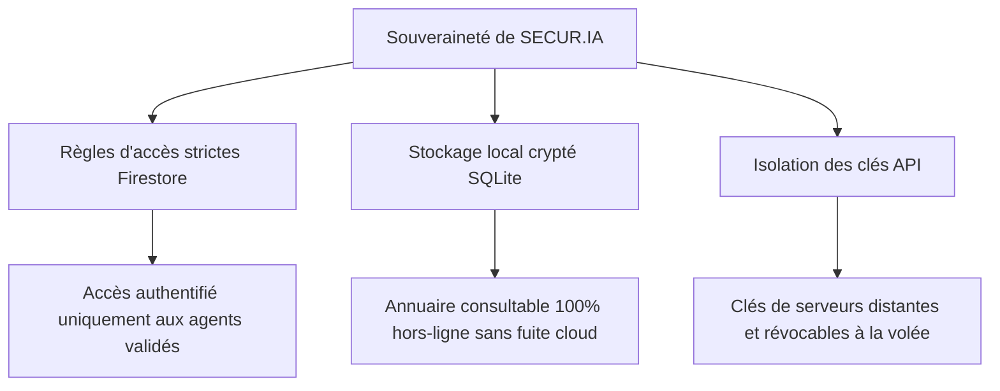

# Chapitre 1 : Vision Stratégique & Transformation Digitale

> *"L'efficacité opérationnelle d'une force de sécurité dépend directement de la fluidité de son accès à l'information. L'IA n'est plus une option futuriste, c'est l'armure informationnelle du policier moderne."*

---

## 1.1. Les défis de la communication au sein des forces de sécurité

Les administrations chargées de la sécurité intérieure font face à un défi paradoxal : elles disposent d'une quantité massive d'informations (lois, décrets, organigrammes, procédures d'enquête, annuaires), mais ces données sont souvent cloisonnées, difficiles d'accès ou obsolètes sur le terrain.

Sur le théâtre des opérations, un fonctionnaire de police doit prendre des décisions critiques en quelques secondes. Qu'il s'agisse de vérifier les limites juridiques d'une garde à vue, de valider la conformité d'un procès-verbal de perquisition ou de contacter d'urgence une unité spécialisée dans une autre région, l'absence d'information instantanée peut compromettre la procédure juridique ou mettre en danger des vies humaines.

Les méthodes traditionnelles souffrent de limites majeures :
*   **Annuaires papiers statiques** : Sujets aux changements de postes fréquents, ils deviennent obsolètes en quelques mois.
*   **Documentation juridique volumineuse** : Le Code pénal et le Code de procédure pénale comptent des centaines de pages. Aucun agent ne peut les mémoriser intégralement ni les transporter en permanence lors des patrouilles.
*   **Lenteur de la transmission administrative** : Les circulaires et règlements intérieurs prennent parfois plusieurs semaines pour atteindre les échelons de terrain, créant une disparité dans l'application des consignes.

---

## 1.2. Le cas d'usage de la police camerounaise (DGSN / POCAM)

Au Cameroun, la Délégation Générale à la Sûreté Nationale (DGSN) gère un vaste réseau d'unités de police réparties sur dix régions, des commissariats centraux aux postes de police frontaliers les plus reculés. 

La **POCAM** (Police Camerounaise) fait face à des contraintes spécifiques de connectivité, d'infrastructures et de diversité géographique (zones forestières, savanes, zones de montagne). Les agents doivent pouvoir travailler aussi bien dans le centre urbain ultra-connecté de Yaoundé ou Douala que dans les localités éloignées de l'Adamaoua ou de l'Extrême-Nord, où le réseau internet est instable.

**SECUR.IA** a été pensée spécifiquement pour répondre à ce besoin d'ubiquité. En combinant un annuaire téléphonique professionnel complet et sécurisé avec un assistant virtuel intelligent, l'application élimine la frontière entre les bureaux de la DGSN et le policier sur la voie publique.

---

## 1.3. L'intelligence artificielle comme assistant opérationnel

Le rôle de l'intelligence artificielle dans SECUR.IA, matérialisé par l'assistant virtuel **Pocam237**, n'est pas de remplacer l'humain ou de prendre des décisions à sa place, mais de servir d'**amplificateur de compétences**.

L'IA agit comme un expert juridique et technique disponible 24h/24 :
*   **Accès instantané au Droit** : L'agent peut poser des questions en langage naturel (ex: *"Quelles sont les conditions de validité d'une perquisition de nuit ?"* ou *"Quels sont les droits d'un mineur lors d'une interpellation ?"*). L'IA extrait les articles précis du Code de procédure pénale camerounais et structure la réponse de manière didactique.
*   **Aide à la rédaction administrative** : Assiste dans la formulation de rapports officiels, de correspondances administratives ou de synthèses d'enquêtes en respectant le style formel requis par la hiérarchie.
*   **Analyse documentaire et d'images** : Grâce aux capacités multimodales, un policier peut photographier un document officiel, un certificat d'immatriculation douteux ou un rapport écrit, et demander à Pocam237 de l'analyser, d'en extraire les incohérences ou de vérifier sa conformité avec les décrets en vigueur.

---

## 1.4. Souveraineté des données et enjeux de sécurité nationale

Le déploiement de technologies intelligentes au sein de forces de l'ordre soulève d'importantes questions de souveraineté et de confidentialité. L'annuaire professionnel de la police nationale et les requêtes des enquêteurs contiennent des données stratégiques sensibles qui ne doivent pas être exploitées par des puissances étrangères ou des entreprises tierces.

La conception de SECUR.IA intègre cette contrainte majeure à travers trois piliers :

*   **Sécurisation de la base de données (Firestore)** : Seuls les utilisateurs authentifiés et explicitement validés par l'administration de la DGSN ont accès à la lecture des contacts professionnels. Les règles de sécurité Firebase empêchent toute fuite de données massive.
*   **Fonctionnement hors-ligne autonome** : L'annuaire opérationnel complet est stocké localement dans une base SQLite cryptée. Aucune requête réseau n'est nécessaire pour consulter les contacts professionnels, ce qui garantit qu'aucune trace de consultation de numéros ne transite sur internet lors des opérations courantes.
*   **Architecture de clés d'API isolée** : En délocalisant la clé d'IA (Gemini API Key) de l'application vers la base de données Firestore sécurisée, le projet évite que la clé ne soit extraite par rétro-ingénierie de l'APK ou compromise lors de l'hébergement du code source.

Par cette architecture, SECUR.IA prouve qu'il est possible de concilier la puissance de l'IA moderne et le respect absolu de la souveraineté numérique nationale.
