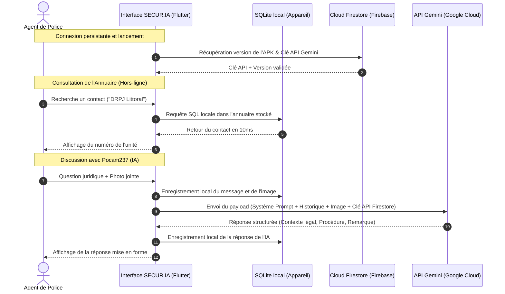

# Chapitre 2 : Architecture Logicielle & Choix Technologiques

> *"Une application de sécurité publique doit être infaillible. L'architecture logicielle n'est pas seulement du code, c'est le garant technique de la résilience opérationnelle."*

---

## 2.1. Pourquoi le choix de Flutter pour une application critique ?

Lors du choix du framework de développement de SECUR.IA, plusieurs critères majeurs devaient être satisfaits : la rapidité de développement, l'homogénéité de l'interface utilisateur, les performances d'exécution, et la compatibilité multiplateforme.

**Flutter**, le SDK open-source développé par Google, s'est imposé comme le choix naturel pour les raisons suivantes :

*   **Compilation native performante** : Contrairement aux frameworks basés sur des vues web (comme Cordova ou Ionic), Flutter compile directement son code en langage machine (ARM/x86). Cela assure des performances graphiques extrêmement fluides à 60 ou 120 images par seconde, indispensables pour l'ergonomie de l'application.
*   **Moteur de rendu autonome (Skia / Impeller)** : Flutter dessine chaque pixel lui-même. Cela garantit qu'une application de police aura exactement le même rendu graphique sur un vieux téléphone Android 5.0 d'entrée de gamme que sur le dernier modèle de smartphone haut de gamme, sans dépendre des feuilles de style du système d'exploitation du fabricant.
*   **Base de code unique (Single Codebase)** : SECUR.IA a été conçu pour Android et iOS en écrivant un seul code source en Dart. Cela permet à une équipe technique restreinte de maintenir l'application, d'ajouter de nouvelles options et de corriger les failles de sécurité simultanément sur toutes les plateformes.

---

## 2.2. Firebase : Une infrastructure Cloud élastique et résiliente

Pour héberger les services d'authentification et de données sans avoir à gérer des serveurs physiques lourds et coûteux, SECUR.IA s'appuie sur la suite de services managés **Firebase** de Google.

```
+-------------------------------------------------------------+
|                        SECUR.IA App                         |
+-------------------------------------------------------------+
                               |
       +-----------------------+-----------------------+
       |                       |                       |
       v                       v                       v
[Authentication]       [Cloud Firestore]       [Gemini AI API]
       |                       |                       |
- Profils agents        - Versioning           - Assistant IA
- Rôles sécurisés       - Clés API distantes   - Analyse de texte
- Jetons d'accès        - Données de secours   - Multimodalité
```

*   **Firebase Authentication** : Gère la création des comptes d'agents, la sécurité des mots de passe et les sessions persistantes de connexion. L'utilisation d'un système robuste d'authentification garantit que l'accès aux données sensibles de l'annuaire est strictement réservé aux agents enregistrés.
*   **Cloud Firestore** : Base de données NoSQL hébergée dans le Cloud, fonctionnant en temps réel. Firestore gère de façon native la persistance des données hors-ligne et permet à l'application de récupérer dynamiquement des configurations (comme les clés d'API ou les variables de mise à jour) sans forcer une recompilation.

---

## 2.3. SQLite local : Garantir la continuité de service hors-ligne

L'une des contraintes majeures sur le terrain en Afrique (et spécifiquement au Cameroun) est l'irrégularité de la couverture réseau internet. Un agent de police ne peut pas se permettre d'attendre qu'une page charge pour contacter un collègue lors d'une intervention critique.

Pour surmonter cela, SECUR.IA utilise une base de données locale **SQLite** via le paquet Flutter `sqflite`.

*   **Autonomie complète** : Au premier démarrage, l'application télécharge l'annuaire complet de la DGSN et l'enregistre localement sur le téléphone. Dès lors, toutes les recherches de contacts s'effectuent en local dans la base SQLite en moins de 10 millisecondes, sans consommer de données mobiles et sans avoir besoin de réseau.
*   **Historique local de chat** : Pour préserver la confidentialité des conversations des enquêteurs avec l'IA Pocam237, tout l'historique de chat et les liens des pièces jointes (photos, rapports) sont stockés localement sur le disque dur interne de l'appareil dans la base SQLite, assurant qu'aucun serveur central ne garde de copie des échanges de travail.

---

## 2.4. Intégration de l'IA Multimodale (Gemini 2.5 Flash)

Pour fournir un assistant virtuel rapide, précis et capable d'interpréter des images et des documents complexes, SECUR.IA intègre le modèle de langage **Gemini 2.5 Flash** de Google.

*   **Vitesse d'exécution** : Le modèle *Flash* a été optimisé pour renvoyer des réponses en temps réel, permettant à l'agent de patrouille d'obtenir ses conseils juridiques ou de procédure en moins de 2 secondes.
*   **Multimodalité native** : Permet à l'agent d'envoyer des photographies de pièces à conviction, de documents administratifs ou de scènes de constatation. Le modèle analyse l'image et l'intègre directement comme contexte pour répondre à la question textuelle de l'enquêteur.
*   **Large fenêtre de contexte** : Permet à l'agent de joindre de volumineux fichiers textes (textes de lois complets, rapports de plusieurs pages). L'IA lit et analyse l'intégralité du document en mémoire locale pour formuler sa réponse.

---

## 2.5. Diagramme global d'architecture de SECUR.IA

Le schéma ci-dessous présente la répartition des flux d'information au sein du système SECUR.IA, montrant l'articulation entre l'interface utilisateur, la persistance locale sur l'appareil de l'agent, et les services distants sécurisés :



Cette architecture découplée assure que l'application reste opérationnelle pour ses fonctions vitales de communication (annuaire) même en zone blanche, tout en exploitant la puissance du Cloud et de l'IA générative dès qu'un accès réseau est détecté.
